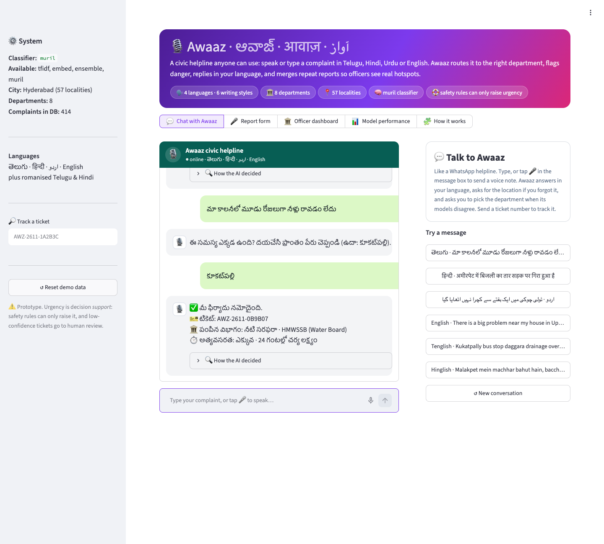
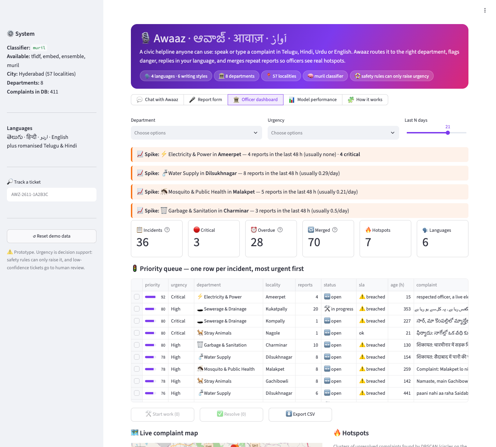
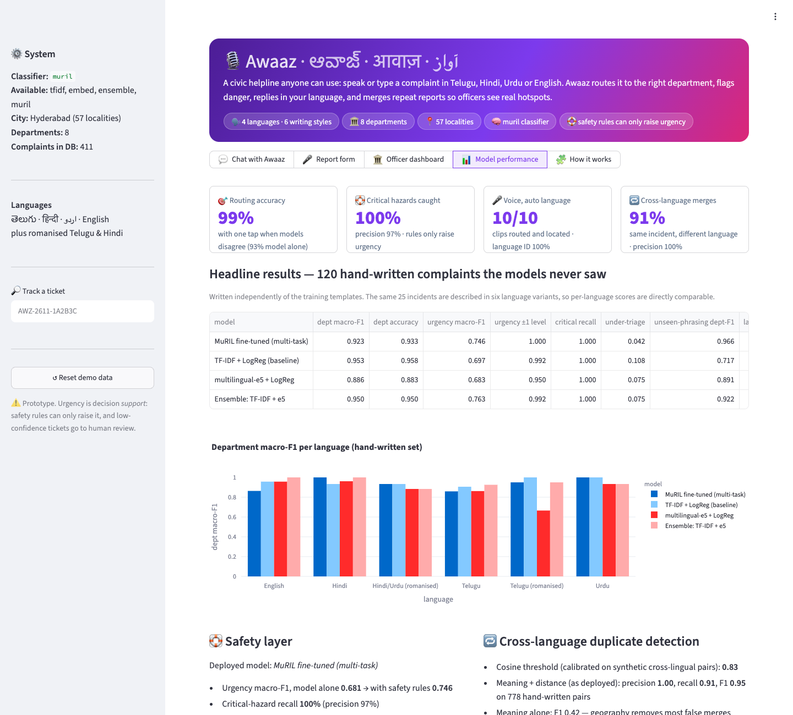
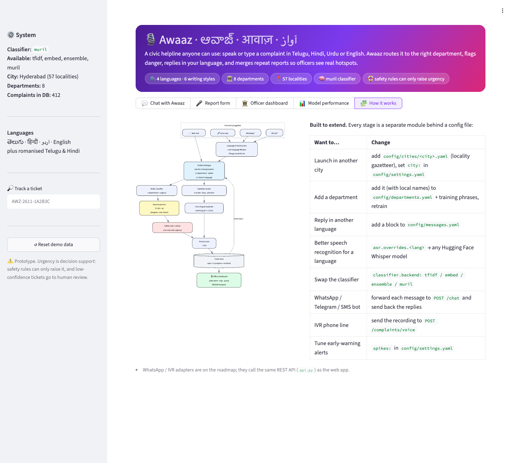

# 🎙️ Awaaz · ఆవాజ్ · आवाज़ · آواز

### A multilingual civic-grievance chatbot: speak or type in Telugu, Hindi, Urdu or English, and Awaaz replies in your language, routes the complaint, flags danger and merges repeat reports into hotspots.

**Neural Storm 2026 · Track 3: Human Impact · Problem Statement HI-02 (Multilingual Citizen Grievance Chatbot)**

| | |
|---|---|
| **Team** | _<TEAM NAME>_ |
| **Members** | _<Member 1>_, _<Member 2>_, _<Member 3>_ |
| **Live demo** | _<deployment link>_ |
| **Demo video** | _<video link>_ |



| Headline (hand-written test set, never trained on) | |
|---|---|
| 🎯 Routing accuracy with one citizen tap | **99.2%** (93.3% model alone) |
| 🛟 Life-threatening hazards caught | **100%** (28/28), precision 97% |
| 🎤 Voice notes, language auto-detected (Telugu, Hindi, English) | **10/10** routed and located |
| 🔁 Same incident reported in different languages, merged | **91%**, with no false merges |

---

## The problem

Hyderabad's civic complaint channels (GHMC, HMWSSB, TGSPDCL) expect citizens to **type**, often in **English**, and to **know which department** owns their problem. That excludes the people who need these services most:

- **Language:** most residents think in Telugu, Hindi/Dakhni or Urdu, and many write in romanised "Tenglish" or "Hinglish".
- **Literacy:** many people cannot type, but everyone can speak.
- **Routing:** "water on the road" might belong to the Water Board (pipe burst) or the Sewerage wing (drain overflow). Wrong routing costs days.
- **Noise:** when one drain overflows, 30 people complain and officers see 30 separate tickets instead of one emergency.
- **Danger:** a fallen live wire or an open manhole waits in the same queue as a flickering streetlight.

## What Awaaz does

A citizen **chats** with Awaaz like a WhatsApp helpline, by typing or sending a **voice note**, in **Telugu, Hindi, Urdu or English**, including romanised and code-mixed text. Awaaz then:

| Step | How |
|---|---|
| 1. **Transcribes** speech | Whisper identifies the language **restricted to te/hi/ur/en**, then the per-language model transcribes: a **Telugu-tuned Whisper** for Telugu (base Whisper wrote Telugu speech in Devanagari) |
| 2. **Detects language/script** | Unicode-script analysis plus a romanised Telugu/Hindi lexicon (6 variants); the bot answers in the same one |
| 3. **Classifies department + urgency** | **multi-task fine-tuned MuRIL**: one Indian-language encoder, two heads |
| 4. **Calibrates confidence** | temperature scaling fitted on validation data, so "90% sure" really means 90% |
| 5. **Applies safety rules** | multilingual hazard lexicon (electrocution, fire, open manhole, injury, life-support, contamination, disease) that can **only raise** urgency |
| 6. **Finds the location** | 57-locality gazetteer in 4 scripts, with fuzzy plus **phonetic** matching that survives typos and ASR errors ("कुकतपली" → Kukatpally) |
| 7. **Merges duplicates across languages** | multilingual-e5 semantic similarity **and** a 1.5 km geo radius |
| 8. **Prioritises** | severity + community corroboration → 0–100 priority score with SLA tracking |
| 9. **Asks instead of guessing** | two fast models give a second opinion; if they disagree, the bot offers the top two departments as one-tap replies. Missing location? It asks for it, in the citizen's language |
| 10. **Replies and advises** | ticket number, department, deadline, and safety advice with helpline numbers (1912 power, 108 ambulance, 101 fire) in the citizen's language |
| 11. **Tracks** | send a ticket number to get its status: open → in progress → resolved |
| 12. **Explains** | the words that drove the decision, top-3 departments with confidence, the safety rule that fired |

Officers get **spike early-warnings** (a locality suddenly reporting far above its usual rate), a **live map**, a **priority queue with duplicates merged** and overdue (SLA) flags, start-work / resolve actions that citizens see when they track their ticket, CSV export, **DBSCAN hotspots**, and trends:



## Results

All headline numbers are on **120 hand-written complaints** that are **not** from the training templates. The same 25 real-world incidents are written in 6 language variants, so the per-language scores compare like with like. Model selection used a separate held-out split, never this set.

### Classification (hand-written test set)

| Model | Dept macro-F1 | Dept acc. | Urgency macro-F1 | Urgency within ±1 level | Under-triage ↓ | Unseen-phrasing dept-F1 | Latency |
|---|---|---|---|---|---|---|---|
| TF-IDF + LogReg (baseline) | **0.953** | **0.958** | 0.697 | 0.992 | 10.8% | 0.717 | 1 ms |
| multilingual-e5 + LogReg | 0.886 | 0.883 | 0.683 | 0.950 | 7.5% | 0.891 | 17 ms |
| Ensemble (TF-IDF + e5) | 0.950 | 0.950 | **0.763** | 0.992 | 7.5% | 0.922 | 18 ms |
| **MuRIL fine-tuned, multi-task** | 0.923 | 0.933 | 0.746 | **1.000** | **4.2%** | **0.966** | 55 ms |

*Unseen-phrasing* = 2,000 synthetic complaints built only from issue phrasings held out of training. This is the split the app uses to **choose its model automatically**. On it the TF-IDF baseline collapses to 0.72 while MuRIL keeps 0.97. The baseline does well on the hand-written set because those complaints reuse everyday civic vocabulary, but it fails when the wording is new. MuRIL is chosen for robustness, and it is also the safest model: no urgency prediction is ever more than one level off, and it has the lowest under-triage rate.

**Per-language department F1 (MuRIL):** English 0.86 · Telugu 0.86 · Hindi 1.00 · Urdu 1.00 · Tenglish 0.95 · Hinglish 0.93

### Ask the citizen when unsure
A fine-tuned model is **confidently wrong** on vague complaints ("there is a big problem near my house" → Roads, 94%), because training data always names an issue. So TF-IDF and e5 give a second opinion (≈18 ms). When any model disagrees, the chatbot offers two departments instead of guessing.

| | |
|---|---|
| Complaints where all models agree (filed straight away) | 80%, routed **100%** correctly |
| Complaints where the bot asks "1️⃣ or 2️⃣?" | 20%; the right department is offered **96%** of the time |
| Routing accuracy | **93.3% → 99.2%** with one tap |

### Safety
- **Critical-hazard recall: 100%** (28/28, precision 97%). Urgency macro-F1 rises from 0.681 (MuRIL alone) to 0.746 (with safety rules).
- **Calibration:** MuRIL was accurate but under-confident. Temperature scaling cut the expected calibration error from **0.73 → 0.03** (department) and **0.38 → 0.13** (urgency), with no change in accuracy.

### Location, duplicates, voice
| | |
|---|---|
| Locality extraction accuracy (hand-written) | **100%** (120/120, 4 scripts) |
| Duplicate detection, as deployed (meaning + distance) | precision **1.00**, recall **0.91**, F1 **0.95** (778 pairs) |
| Duplicate detection, meaning alone | F1 0.42 (geography is what removes false merges) |
| Same incident reported in a *different language* | **91%** merged correctly |
| End-to-end voice, **no language hint** (10 clips: 5 Telugu, 3 Hindi, 2 English) | language **10/10**, department **10/10**, location **10/10** |
| Telugu speech, base Whisper-small vs Telugu-tuned Whisper | Devanagari gibberish or repetition loops → near word-perfect Telugu script |

Confusion matrices are in [`reports/figures/`](reports/figures). All numbers are in [`reports/metrics.json`](reports/metrics.json) and can be regenerated with the commands below.



## Architecture



```
awaaz/                 core library (no UI code)
  chat.py              the chatbot: asks for what is missing, replies in the citizen's language
  text.py              normalisation, language/script detection, phonetic skeletons
  asr.py               restricted language ID + per-language Whisper (HF | faster-whisper)
  classify.py          TF-IDF | e5 | Ensemble | MuRIL backends, one interface
  muril.py             multi-task MuRIL model (shared encoder, two heads)
  rules.py             safety rules (can only raise urgency)
  locate.py            gazetteer locator: exact → fuzzy → phonetic
  cluster.py           cross-lingual duplicate matching, DBSCAN hotspots, spike alerts
  pipeline.py          Awaaz engine: analyze() / submit() → Ticket, with second-opinion models
  store.py             SQLite ticket store (open → in progress → resolved)
  synth.py, demo.py    training-data generator, demo database
config/                everything city/department/language-specific (YAML), incl. bot replies
ui/                    Streamlit pages: chat, report, dashboard, model_report, about
app.py                 web app entry point
api.py                 FastAPI REST API for other channels
scripts/               train.py, train_muril.py, eval_voice.py, eval_committee.py, seed_db.py, make_audio_samples.py
tests/                 pytest suite
```

## Data

There is **no public labelled dataset** of civic grievances in Telugu, Urdu and Hindi, so we built our own and evaluated it strictly.

- **Training corpus (`awaaz/synth.py`, 8,000 complaints).** Hand-written building blocks in 6 language variants:
  - ~280 issue clauses across 8 departments, each with a base urgency
  - duration and vulnerability sentences ("for a month now", "elderly and children live here") that **raise urgency**, so the model must read context
  - terse app-style complaints ("no water since morning")
  - 57 real localities, often written in English inside native-script sentences (as people really write), plus typo, case and punctuation noise
  - **Locality names are masked** before classification, so models can't learn spurious place→department shortcuts.
- **Unseen-phrasing test (2,000).** 1–2 issue clauses per (department, language) cell are held out of training entirely.
- **Hand-written test (`data/test_handwritten.jsonl`, 120).** Free-form complaints, parallel across languages. Never used for training or model selection.

## Run it

```bash
git clone <this repo> && cd awaaz
python -m venv .venv && source .venv/bin/activate
pip install -r requirements.txt               # ffmpeg must be on PATH for voice input

python scripts/train.py                       # data + TF-IDF, e5, ensemble + evaluation  (~3 min)
python scripts/train_muril.py                 # optional: fine-tune + calibrate MuRIL  (~25 min on Apple M2, ~6 min on T4)
python scripts/eval_voice.py                  # optional: end-to-end voice evaluation (language auto-detected)
python scripts/eval_committee.py              # optional: "ask when unsure" routing evaluation

streamlit run app.py                          # web app → http://localhost:8501  (seeds a demo database on first run)
uvicorn api:app --reload                      # REST API → http://localhost:8000/docs  (/chat, /complaints, /spikes …)
pytest -q                                     # 42 tests
```

The app automatically uses the best trained model it finds. MuRIL weights (~950 MB) are not committed, so a fresh clone or cloud deployment runs the **ensemble** until `train_muril.py` is run.

Docker (also works as a Hugging Face Space):
```bash
docker build -t awaaz . && docker run -p 7860:7860 awaaz
```

## Built to extend

| Want to… | Do this |
|---|---|
| Launch in another city | add `config/cities/<city>.yaml`, set `city:` in `config/settings.yaml` |
| Add a department | add it to `config/departments.yaml`, add phrases in `awaaz/synth.py`, run `scripts/train.py` |
| Reply in another language | add a block to `config/messages.yaml` (and local department names) |
| Better speech recognition for a language | `asr.overrides: {<lang>: {model: <whisper-checkpoint>}}` (Telugu already uses one) |
| Swap the classifier | `classifier.backend: tfidf / embed / ensemble / muril` |
| WhatsApp / Telegram / SMS bot | forward each message to `POST /chat` and send back the replies |
| IVR phone line | send the recording to `POST /complaints/voice` |
| Use the engine elsewhere (hospitals, campuses, utilities) | new department + gazetteer YAML; the pipeline is domain-agnostic |

**Roadmap:**
- WhatsApp and IVR adapters on top of `/chat` and `/complaints/voice`
- photo complaints (vision model for potholes and garbage)
- pushing a message to the citizen, in their language, when their ticket's status changes
- forecasting seasonal hotspots (monsoon drain overflows)
- active learning from officer corrections

## Responsible AI and limitations

- **Decision support, not decision maker.** Every ticket shows its confidence, explanation and rule hits. When the models disagree the citizen is asked, and the ticket is flagged for officer review; a missing location is flagged too.
- **Safety-first asymmetry.** Rules only raise urgency. We report **critical recall** and **under-triage rate**, not just accuracy.
- **Honest caveats:**
  - Training data is synthetic, and the hand-written set (120) is small. A real pilot on anonymised GHMC/HMWSSB data is the next step.
  - The *medical-dependency* safety rule (oxygen, dialysis) and two Tenglish verb forms were added **after error analysis on the hand-written set**, so its 100% critical recall is optimistic. Before that change it was 79–82%.
  - Household-power phrasings ("ghar mein light nahi hai": in Hinglish "light" means power, not streetlights) were added to the training data after an API smoke test exposed the gap.
  - MuRIL results vary by a few F1 points between fine-tuning runs (an earlier run scored 0.956 hand-written department F1). We report the latest run.
  - Voice test clips are synthetic text-to-speech (macOS voices for Hindi/English, Google TTS for Telugu); real, noisy recordings are still needed. Urdu speech uses base Whisper-small, which is weaker.
  - The bot's replies and safety advice were written for this prototype; native-speaker review of the Telugu, Urdu and Hindi text is recommended.
  - The "ask when unsure" numbers come from the same 120-complaint test set the rest of the evaluation uses; its threshold was not tuned on it.
- **Privacy.** No names or phone numbers are collected. Map pins are jittered within the locality.

## Tech stack

Python 3.12 · PyTorch · Hugging Face Transformers (**MuRIL**, **Whisper**) · sentence-transformers (**multilingual-e5-small**) · scikit-learn (LogReg, DBSCAN) · RapidFuzz · Streamlit · Folium/OpenStreetMap · Plotly · FastAPI · SQLite

## AI tools disclosure

This project was built with help from **Claude Code (Anthropic)** as an AI coding assistant, used for scaffolding code, writing the data generator and drafting documentation. Problem framing, design decisions, evaluation and review are by the team. Pretrained models used: `google/muril-base-cased`, `intfloat/multilingual-e5-small`, `openai/whisper-small`, `vasista22/whisper-telugu-small` (Telugu ASR). Telugu test clips were generated with Google Text-to-Speech (gTTS).
